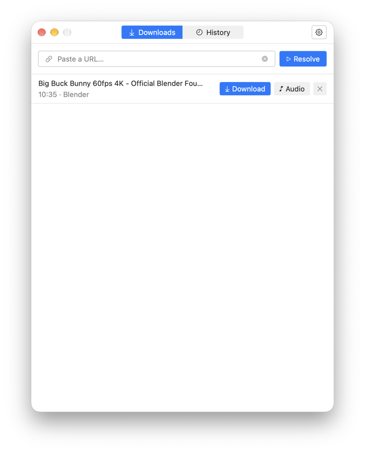
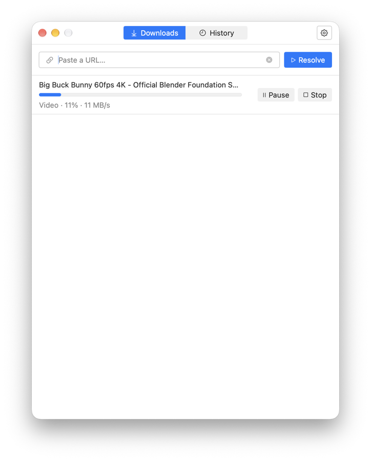
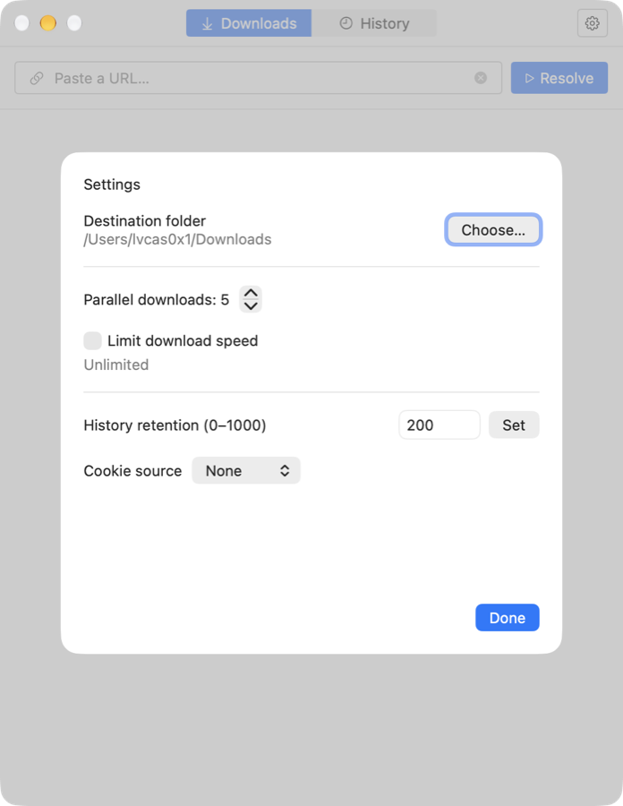

# Downloader

Downloader is a free, open-source macOS menu-bar app for downloading video and audio from the web. It is a simple front end for [yt-dlp](https://github.com/yt-dlp/yt-dlp), with yt-dlp, FFmpeg, and Deno bundled, so nothing else needs to be installed.

| Resolve a URL | Download | Settings |
|---|---|---|
|  |  |  |

## Features

- **Paste and resolve:** paste a URL to see the title, duration, and channel before downloading.
- **Video or audio:** download the video, or extract the audio as MP3 (256 kbps).
- **Playlists:** a playlist, channel, or collection lists every entry, with **Download all** and **Audio all**.
- **Queue control:** pause, resume, and stop each download, with progress and speed. Stop deletes the partial files.
- **Parallel downloads** and an optional **speed limit**.
- **History:** finished and failed downloads are kept (up to 1000 records), and each can be downloaded again.
- **Browser cookies:** optionally use cookies from Safari, Chrome, Firefox, Edge, or Brave for content that needs a sign-in.
- **Self-contained:** uses only its bundled copies of yt-dlp, FFmpeg, and Deno, never system-installed ones.
- **Automatic updates** through Sparkle: Downloader checks for new versions and installs them when you agree.

## Installation

Requirements: macOS 14 or later on Apple Silicon.

1. Download `Downloader-<version>.dmg` from the [latest release](https://github.com/lvcas0x1/downloader/releases/latest).
2. Open the DMG and drag **Downloader** to **Applications**.
3. Open Downloader once. The app is not notarized, so macOS blocks it the first time: go to **System Settings > Privacy & Security** and click **Open Anyway**.

Downloader has no Dock icon. Look for the download icon (↓ in a circle) in the menu bar.

### Updates

Downloader checks for updates automatically and asks before installing one. To check now, right-click the menu-bar icon and choose **Update**.

If you installed a version without **Update** in its menu, install the latest release once by hand as above; later versions update themselves.

## Usage

Click the menu-bar icon to show or hide the window. Right-click it for **Open Downloader**, **Update**, and **Quit Downloader**.

### Downloading

1. Paste a URL into **Paste a URL…** and press Return or click **Resolve**.
2. Click **Download** for the video, or **Audio** for an MP3. For a playlist, use **Download all** or **Audio all**, or pick single entries.
3. While downloading, use **Pause**, **Resume**, or **Stop**. A paused download continues from where it stopped.

Files are saved to `~/Downloads` by default, named `<title> [<id>].<ext>`. Existing files are never overwritten.

### History

The **History** tab lists finished and failed downloads. Download an entry again with **Download** or **Audio**, remove one entry, or remove all with **Clear all**. Removing a record does not delete the downloaded file.

### Settings

Click the gear button to set:

| Setting | Default |
|---|---|
| Destination folder | `~/Downloads` |
| Parallel downloads | 3 |
| Limit download speed | Off (unlimited) |
| History retention (0–1000 records) | 200 |
| Cookie source (None, Safari, Chrome, Firefox, Edge, Brave) | None |

Only download content you have the right to download, and follow each site's terms of service.

## Third-party components

The app bundles these programs and runs them as separate processes. Each keeps its own license; the full texts are in the app at `Contents/Resources/bin/licenses/`.

| Component | License |
|---|---|
| [yt-dlp](https://github.com/yt-dlp/yt-dlp) (official `yt-dlp_macos` build) | yt-dlp itself is Unlicense; the build includes GPL code, so the build as a whole is GPL-3.0-or-later |
| [FFmpeg](https://ffmpeg.org/) (`ffmpeg`, `ffprobe`, built from source) with [LAME](https://lame.sourceforge.io/) | LGPL-2.1-or-later (FFmpeg), LGPL-2.0-or-later (LAME) |
| [Deno](https://github.com/denoland/deno) | MIT |
| [Sparkle](https://github.com/sparkle-project/Sparkle) (update framework, embedded) | MIT |

The source code of yt-dlp, FFmpeg, and LAME, and the FFmpeg build script, are attached to every [release](https://github.com/lvcas0x1/downloader/releases) next to the DMG. Details: [`Resources/bin/THIRD_PARTY_NOTICES.md`](Resources/bin/THIRD_PARTY_NOTICES.md).

## Contributing

Build instructions, project layout, and dependencies: [README-dev.md](README-dev.md).

## License

Downloader's own source code is licensed under the [MIT License](LICENSE). The bundled third-party programs are licensed under their own terms (see above).
